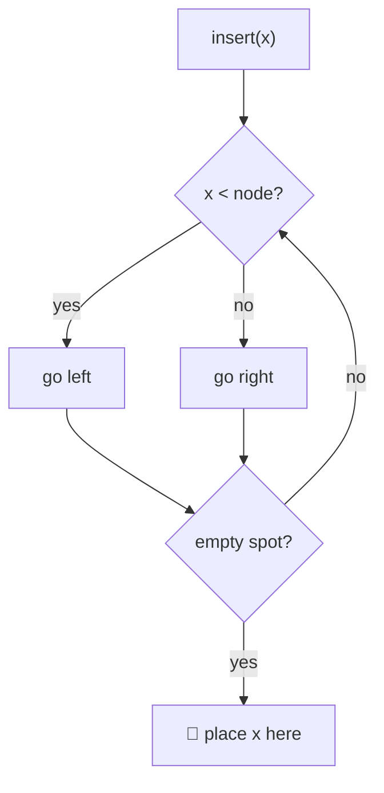

<div align="center">




<p>


</p>
<p>


</p>

**[🌐 Open the playground](https://hemashreevi.github.io/bst-playground/)** · **[✨ Features](#-features)** · **[🧠 What you'll learn](#-what-youll-learn)** · **[🗺️ Roadmap](#%EF%B8%8F-roadmap)**

</div>

---

## 💡 Why?

Binary search trees look simple on paper, until you have to **delete a node with two children** or work out **how many insert orders build the same tree**. Static diagrams don't show *how* the tree changes.

**BST Playground animates every comparison and every pointer move**, so you can see the algorithm instead of imagining it.

## ✨ Features

<table>
<tr>
<td width="33%" align="center">➕<br/><b>Animated insert</b><br/><sub>Watch the value compare its way down: smaller goes left, bigger goes right</sub></td>
<td width="33%" align="center">🗑️<br/><b>All 3 delete cases</b><br/><sub>Leaf, one child, and two children with the in-order successor highlighted</sub></td>
<td width="33%" align="center">🔍<br/><b>Search trace</b><br/><sub>The path lights up and shows how many steps it took</sub></td>
</tr>
<tr>
<td align="center">🚶<br/><b>4 traversals</b><br/><sub>In, pre, post and level order, walked node by node</sub></td>
<td align="center">⏯️<br/><b>Step mode</b><br/><sub>Pause, step forward or back, change speed, with a plain-English explanation of each step</sub></td>
<td align="center">🧩<br/><b>LeetCode 1569 mode</b><br/><sub>Count the insert orders that build the <i>same</i> tree, and see why</sub></td>
</tr>
<tr>
<td align="center">📏<br/><b>Live stats</b><br/><sub>Height, node count, balanced or skewed, and Big-O for each operation</sub></td>
<td align="center">🎲<br/><b>Quick builds</b><br/><sub>Paste an array, generate a random tree, or a worst-case sorted one</sub></td>
<td align="center">☕<br/><b>Java code panel</b><br/><sub>The matching Java code, with the running line highlighted</sub></td>
</tr>
</table>

## 🎬 Demo

> 🛠️ *GIFs of insert, delete and traversal go here once they're built.*

## 🧠 What you'll learn

| Operation | Average | Worst (skewed tree) | Shown in the playground |
|---|:-:|:-:|---|
| Search | `O(log n)` | `O(n)` | path highlight and step counter |
| Insert | `O(log n)` | `O(n)` | compare-and-descend animation |
| Delete | `O(log n)` | `O(n)` | successor swap, visualised |
| Traversal | `O(n)` | `O(n)` | node-by-node walk |



## ⚡ Run locally

```bash
git clone https://github.com/HemashreeVI/bst-playground.git
cd bst-playground
python -m http.server 8000     # then open http://localhost:8000
```

## 🗂️ Project structure

```
bst-playground/
├── index.html      # layout and controls
├── style.css       # theme and animations
├── bst.js          # the tree: insert, delete, search, traversals
├── render.js       # draws and animates the tree in SVG
└── lc1569.js       # "number of ways to reorder" mode
```

## 🗺️ Roadmap

- [ ] **Step 1:** Draw a tree from an array
- [ ] **Step 2:** Animated insert and search
- [ ] **Step 3:** Delete, all three cases
- [ ] **Step 4:** Four traversals with step mode
- [ ] **Step 5:** LeetCode 1569 mode and the Java code panel
- [ ] *Stretch:* AVL rotations, shareable tree links

## 🧰 Built with

<p align="center"></p>

---

<div align="center">

**Built by [Hemashree V I](https://hemashreevi.github.io)** while learning BSTs from zero 🌳

<a href="https://hemashreevi.github.io"></a>
<a href="https://www.linkedin.com/in/hema-shree-373622289"></a>
<a href="mailto:shreejith2005@gmail.com"></a>

</div>
